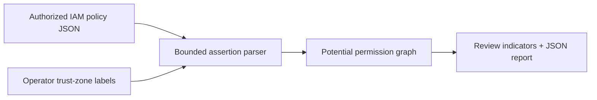

# Architecture and threat model

The CLI receives one explicitly supplied AWS IAM identity-policy JSON and principal ARN. It parses supported statements, emits potential Allow edges and separate Deny assertions, records statement/source hashes, and compares with an optional previous report. A separate operator-supplied map labels trust zones. No AWS API or policy write is invoked.

Threats include interpreting an Allow as effective access, ignoring explicit denies, exposing IAM structure, and unsafe mutation. The report repeatedly labels its graph as assertions, leaves unsupported constructs unexpanded, and has no credential or write path. Source documents and reports may reveal sensitive architecture; restrict access. Future validation requires complete policy context and explicit analyst review.
